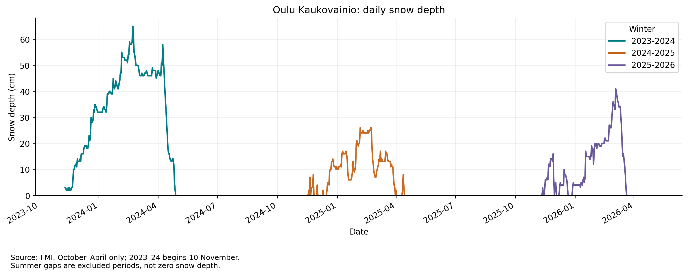
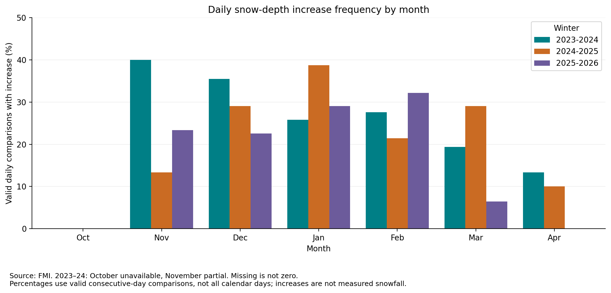
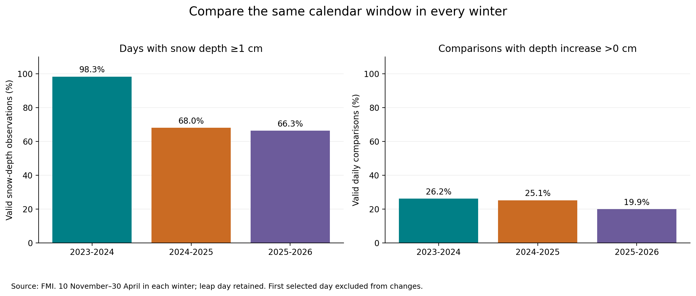
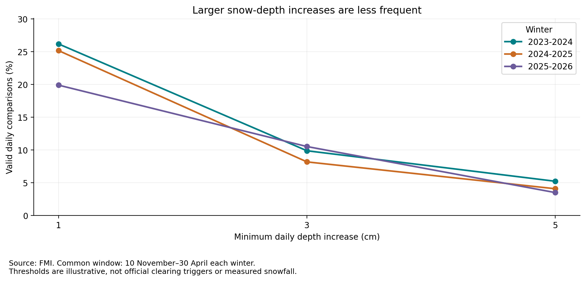
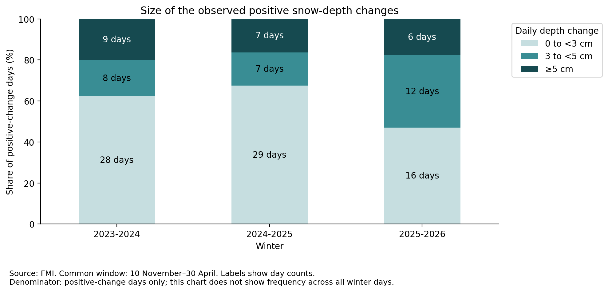

# Oulu snow analysis

A reproducible Python feasibility study of residential snow-clearing services in Oulu, Finland, using Finnish Meteorological Institute observations from Oulu Kaukovainio.

**Version 2:** reusable analysis functions, explicit coverage auditing, nine edge-case tests, five static charts and an offline interactive chart. The main seasonal comparisons now consistently use the same calendar window.

**Business question:** Do recent snow conditions justify investigating an expansion of residential snow-clearing services?

**Conclusion:** Recurring snow-depth increases support further investigation. These observations alone do not establish customer demand, clearing-job counts, or profitability.

## What is in the data?

The download was requested for October 2016–April 2026, but the actual observations begin in November 2023. This is **not a ten-year dataset**.

| Winter | Available dates | Daily records | Coverage |
|---|---|---:|---|
| 2023–2024 | 10 Nov 2023–30 Apr 2024 | 173 | Partial |
| 2024–2025 | 1 Oct 2024–30 Apr 2025 | 212 | Complete October–April window |
| 2025–2026 | 1 Oct 2025–30 Apr 2026 | 212 | Complete October–April window |

The raw workbook contains 904 rows. One row has no weather measurements; removing it and selecting October–April leaves **597 records**, exceeding the assignment's 200-record minimum. There are no duplicate dates in the winter dataset.

## Results and visualizations

The original analysis identifies 45, 43 and 34 days with positive snow-depth changes, from 172, 211 and 211 valid daily comparisons respectively. Snow cover of at least 1 cm occurs on 170, 117 and 114 observed days. The first winter has different coverage, so raw seasonal totals should not be compared as equal periods.





### Added portfolio assessments

1. **Common-calendar comparison:** use 10 November–30 April in every season and recompute changes within that window. Rates use valid observations; the leap winter has one extra day.
2. **Threshold sensitivity:** compare increases of at least 1, 3 and 5 cm using the common window. Keep the available-window results as a separate exported table. These are illustrative thresholds, not official clearing triggers or verified snowfall amounts.
3. **Increase magnitude:** distinguish the size of positive changes from their frequency. In the common window, 2025–26 has fewer positive-change days than 2024–25 (34 versus 43), but more days reaching at least 3 cm (18 versus 14).
4. **Coverage audit:** distinguish absent calendar dates, missing readings and valid zeros. The first winter has 81.2% valid snow coverage of its full October–April calendar; the other two have 100%.
5. **Interactive daily chart:** hover for values, select seasons in the legend and zoom using a range slider. Download [the HTML chart](outputs/interactive_snow_depth.html) and open it locally; GitHub does not run its JavaScript in the file preview. It works offline.







Read [the detailed assessment](ASSESSMENT.md) for the new results and interpretation.

## Run locally

Use Python **3.9–3.12**; Python 3.11 is a suitable choice for the pinned dependencies. Download this repository as a ZIP and extract it, or clone it with Git. Open a terminal in the repository folder.

```bash
python -m venv .venv
```

Activate the environment:

```bash
# macOS / Linux
source .venv/bin/activate

# Windows PowerShell (use this instead)
.venv\Scripts\Activate.ps1
```

Install packages and execute all notebook cells:

```bash
python -m pip install -r requirements.txt
python scripts/run_analysis.py
```

The runner uses the active Python environment, saves the executed notebook, and regenerates the Excel workbook, CSV tables, five PNG figures and standalone interactive HTML. No personal paths or Google Drive authentication are needed. Existing generated outputs are replaced when rerunning.

Run the nine focused tests before changing the dataset or calculation rules:

```bash
python -m unittest discover -s tests -v
```

The tests cover sentinel values, preserving raw input, date gaps, missing snow readings, winter boundaries, common-window boundaries, leap years, threshold inclusion, invalid data and numeric date strings. Snapshot assertions in the notebook separately confirm the results of the included FMI file.

For interactive work, open `DABI_FINAL_ASSIGNEMT.ipynb` in VS Code with its Python/Jupyter support and select the `.venv` interpreter. Alternatively install JupyterLab in the same environment and launch it:

```bash
python -m pip install jupyterlab
python -m jupyter lab
```

## Run in Google Colab

Opening a notebook from GitHub does not automatically copy its data files into Colab. In a new Colab notebook, clone your published repository first, replacing `YOUR_GITHUB_USERNAME` with its owner:

```python
!git clone https://github.com/YOUR_GITHUB_USERNAME/oulu-snow-analysis.git
%cd /content/oulu-snow-analysis
%pip install -r requirements.txt
!python scripts/run_analysis.py
```

Alternatively open the analysis notebook in Colab, add the clone/change-directory/install commands above before the first analysis cell, then run its cells. The `/content/` location is specific to this Colab setup example; the analysis itself uses portable relative paths. Generated files appear in the cloned repository's `outputs/` directory.

## Repository contents

```text
DABI_FINAL_ASSIGNEMT.ipynb       Executed analysis with explanations
snow_analysis.py                Validation and reusable analysis functions
snow_charts.py                  Reusable chart functions
requirements.txt                Pinned direct dependencies
scripts/run_analysis.py          Re-run every notebook cell
tests/test_analysis.py           Synthetic edge-case tests
data/raw/*.xlsx                  Original FMI snapshot (unchanged bytes)
data/README.md                   Provenance, licence and checksum
outputs/figures/*.png            Five static charts
outputs/interactive_snow_depth.html
outputs/DABI_Oulu_Snow_Analysis.xlsx
outputs/*.csv                   Derived data and summary tables
ASSESSMENT.md                   Findings and limitations
```

## Methods and limitations

- Basic descriptive statistics; no forecasting or causal claims.
- `-` becomes missing. The all-weather-missing row is excluded from calculations but retained in the coverage audit.
- Snow/precipitation sentinel `-1` becomes zero only in new processed columns. Original fields remain available. Negative temperatures remain valid. Raw precipitation zero denotes a trace below 0.1 mm and is approximated as zero numerically.
- Snow cover means measured snow depth **at least 1 cm**, not snowfall or new accumulation.
- Daily changes are valid only within a winter and between consecutive dates. Missing comparisons are not counted as zero.
- The short, single-station record cannot establish a long-term climate trend or represent every property in Oulu. Settling, melting, wind redistribution and measurement variation affect depth changes.
- No customer willingness-to-pay, competitor or delivery-cost data is included. Commercial feasibility remains unproven.

## Sources, attribution and AI use

Data: **Finnish Meteorological Institute, Oulu Kaukovainio daily weather observations**.

- [Download observations](https://en.ilmatieteenlaitos.fi/download-observations)
- [Observation definitions](https://www.ilmatieteenlaitos.fi/neuvoja-havaintosuureisiin)
- [FMI data licence](https://en.ilmatieteenlaitos.fi/open-data-licence): [CC BY 4.0](https://creativecommons.org/licenses/by/4.0/).

The raw workbook is preserved; derived data is modified as documented. No FMI endorsement is implied. The data licence is separate from rights in the student-authored code and writing; no additional software licence has been selected.

AI assisted with explanations, debugging, refactoring, tests, documentation, portability changes, and additional analyses and visualizations. This repository is an expanded portfolio edition of the DABI final assignment; the additions should not be represented as part of the originally submitted work. The student remains responsible for reviewing and understanding the analysis.
